# cli-resume

重启电脑后，把 `codebuddy` / `claude` 的终端现场一把拉回来。

不维护项目清单、不记笔记、不用手动 `cd` —— 直接读各个 CLI 自己落的会话历史，
还原出「上次在哪些目录干活、会话 id 是多少」，然后 `--resume` 回去。
桌面端还能把会话直接开在应用自己的终端面板里（ConPTY + xterm.js），不再弹外部终端窗口；
多个会话并排看，也能随时切回外部终端。想不起上次在哪个目录说过某件事，回车直接搜会话正文。

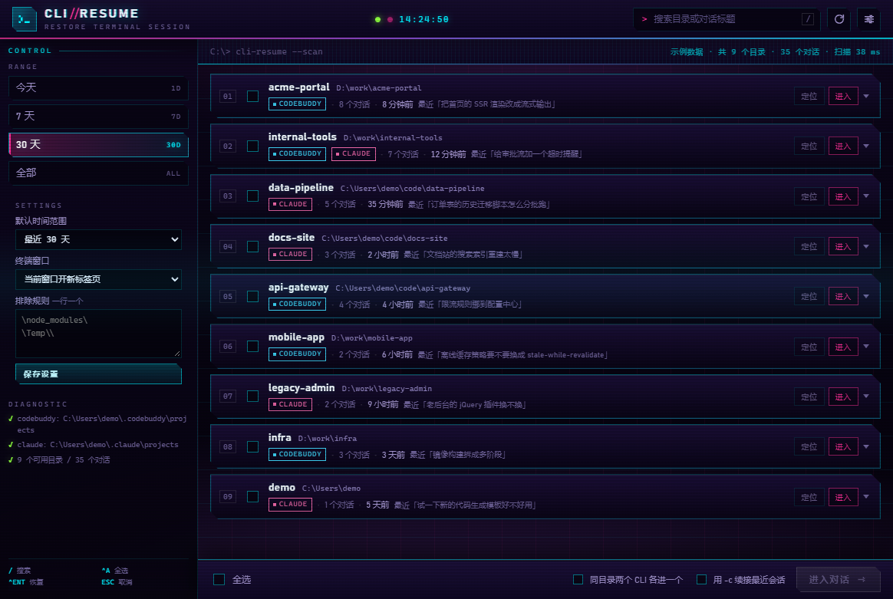
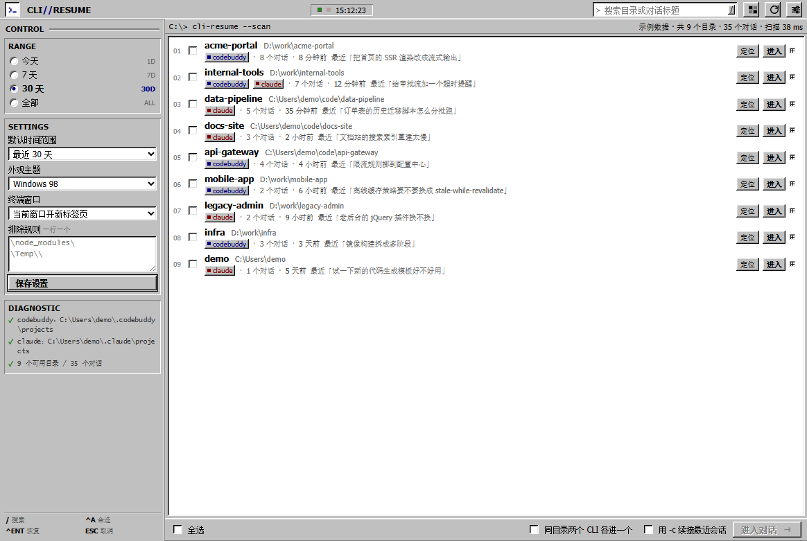
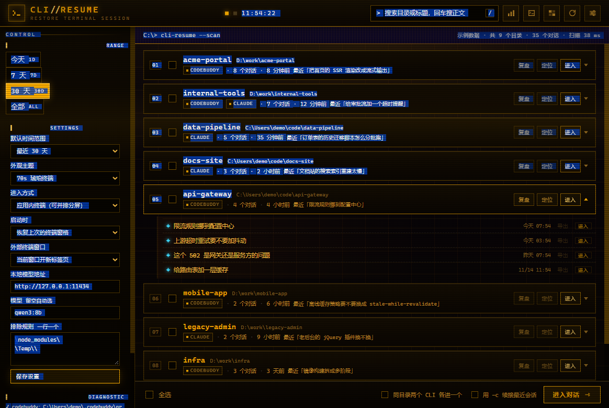
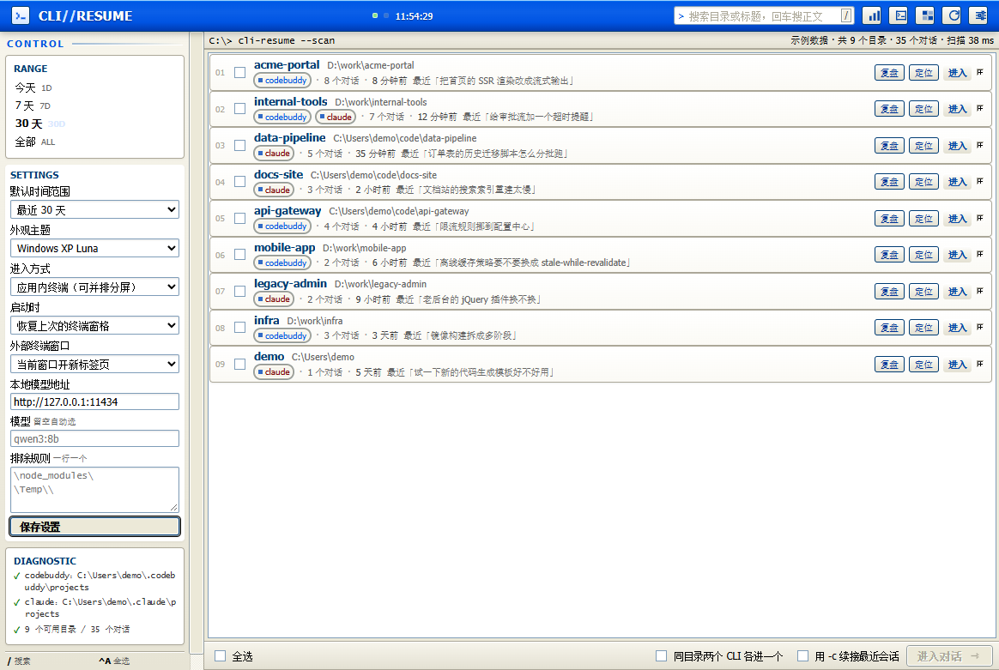

桌面端有四套皮肤，顶栏那个按钮循环切换：

- **80s 霓虹 CRT**：紫黑底、青与品红双霓虹、扫描线、网格地平线
- **70s 琥珀终端**：P3 荧光粉的单色橙黄，没有彩色，只有亮暗；等宽字体、方形控件
- **Windows 98**：灰面板、四层 1px 立体线、深蓝选中、宋体小字、16px 经典滚动条
- **Windows XP Luna**：蓝渐变标题栏、米黄客户区、圆角渐变按钮、Tahoma

选择记在 `settings.json` 里，下次启动就是上次那套。任何程序里按 **Ctrl+Shift+Space** 都能把窗口
拉出来，再按一次收起 —— 不用去任务栏找。

## 支持哪些 agent

| agent | 会话位置 | 支持程度 |
|---|---|---|
| CodeBuddy CLI | `~/.codebuddy/projects/<目录>/<sid>.jsonl` | 全量：列表 / 搜索 / 恢复 / 导出 / 统计 |
| Claude Code | `~/.claude/projects/<目录>/<sid>.jsonl` | 全量 |
| Codex CLI | `~/.codex/sessions/YYYY/MM/DD/rollout-*.jsonl` | 全量（`codex resume <id>`） |
| Kimi CLI | `~/.kimi-code/sessions/<工作区>/session_<uuid>/` | 全量（`kimi -S session_<uuid>`） |
| Qoder | `~/.qoder/projects/<项目>/<sid>` | 仅检测（对话不落本地） |
| Qwen Code | `~/.qwen` | 仅检测（本机还没产生会话） |

左栏 DIAGNOSTIC 会列出本机装了哪些 agent、各自多少会话：✓ 是已接入，· 是检测到但暂不支持。
检测只读目录，不解析内容，所以很快。

Qoder 只做检测不是偷懒：`projects/<项目>/<sid>/state.json` 里 `data` 和 `items` 都是空的，
`logs/sessions/.../segments/*.jsonl` 只是 hook 与 phase 生命周期日志，日志里提到的
transcript 文件写完之后并不存在。也就是说它的对话没有落到本地，没有可读的东西。

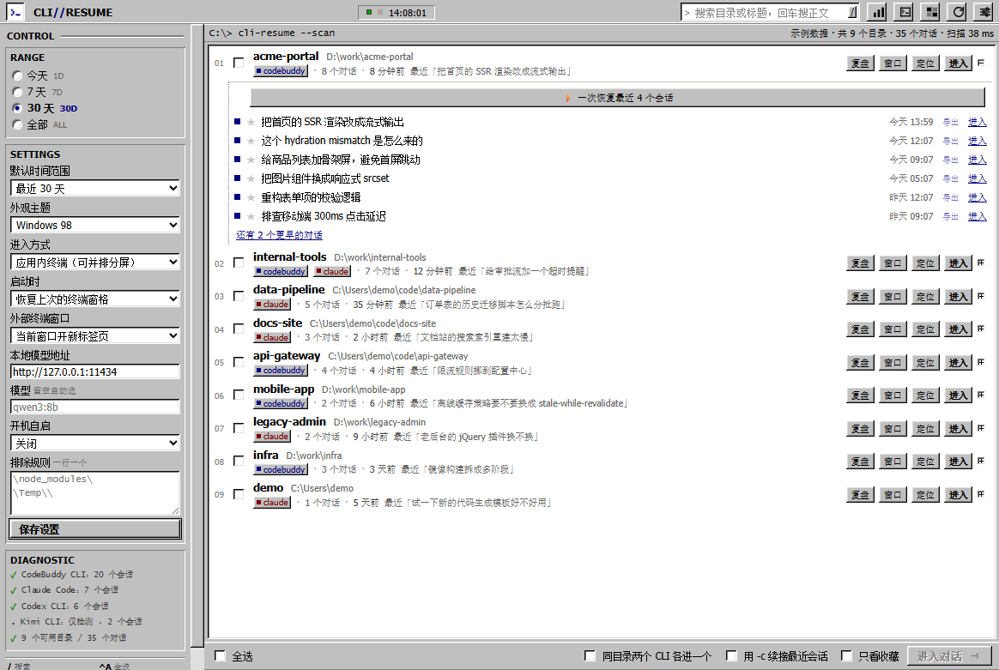

## 工作区窗口

点卡片上的「窗口」，这个目录会单独开一扇窗，只列它自己的会话，标题写目录名。
同一目录再点一次不会叠第三个，而是把已经开着的那扇提到前面。适合把一个项目钉在副屏，
主窗口继续扫全部目录。每扇窗各自记住终端布局，互不影响。

关掉窗口不是退出：程序收进托盘（右键图标有显示/隐藏、开机自启、退出），
`settings.json` 旁边还有 `开机自启` 开关，打开后开机直接驻留托盘，等热键叫它。

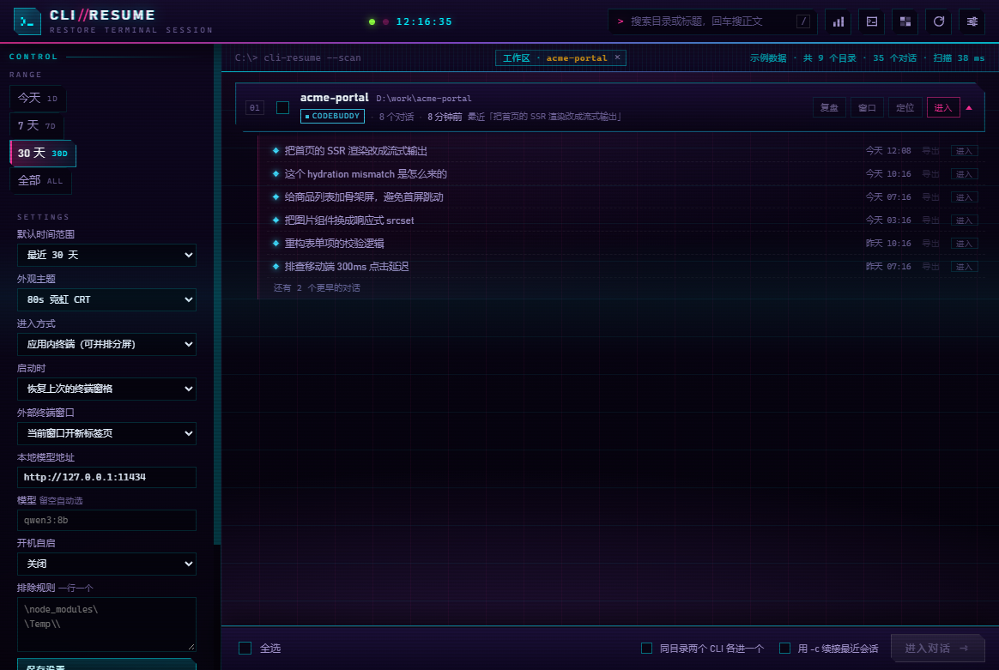

## 收藏与批量恢复

会话行左边的星是收藏：点了就置顶 —— 同一个目录里收藏的永远排在前面，哪怕它已经是一个月前的。
卡片上会显示「★ N」。底部「只看收藏」把范围收成收藏过的会话，翻旧账时不用在几十条里找。

展开一个目录后还有「一次恢复最近 N 个会话」：内嵌面板最多 4 个窗格，外部终端一次开 8 个标签，
标签上写清楚上限，超出会告诉你还剩几条没开。收藏状态跨窗口共享，任何一扇窗里点星，切回另一扇
会自己同步。

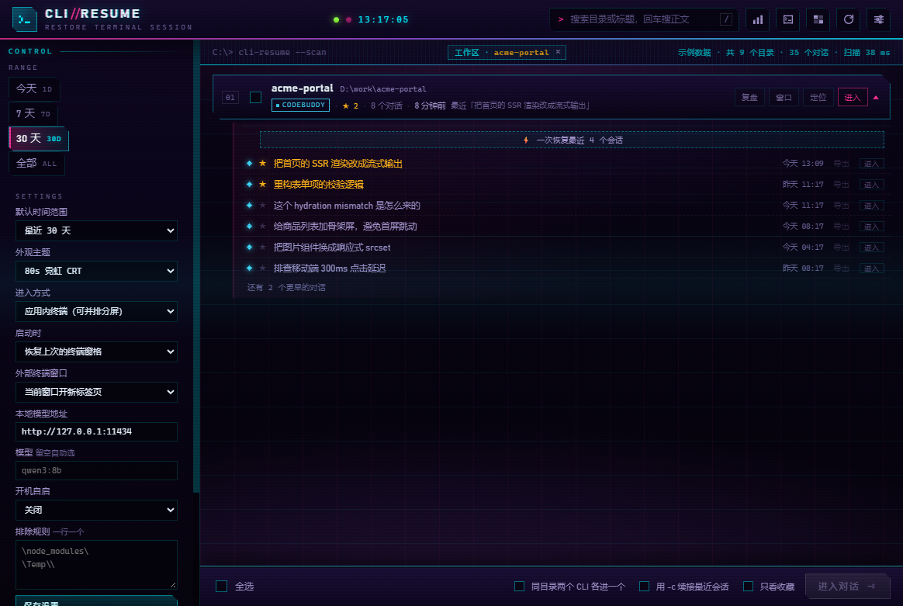
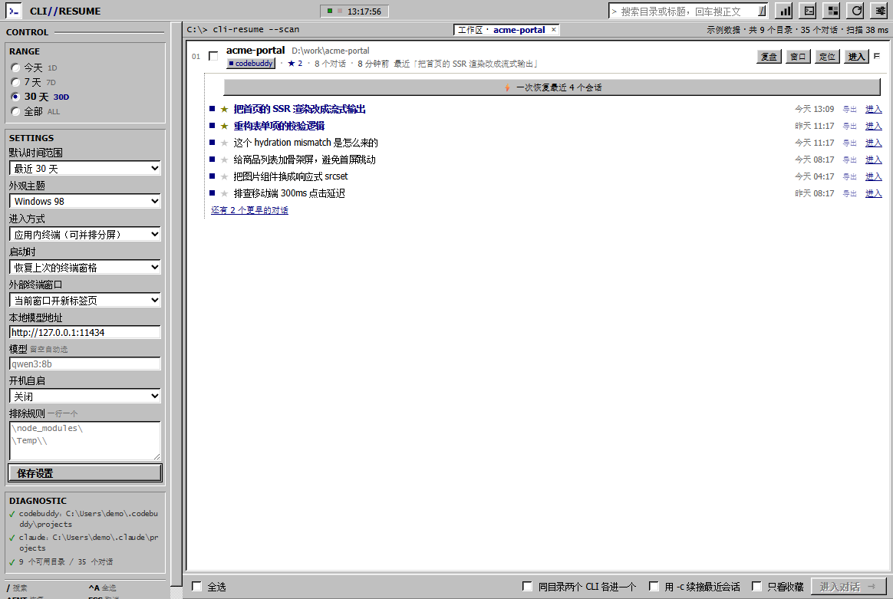

## 两种形态，同一套思路

| | 命令行版 | 桌面端 |
|---|---|---|
| 入口 | `cr list` / `cr open` | 双击窗口，可设开机自启 |
| 颗粒度 | 工作区级：每个目录开一个标签 | 对话级：点标题直接进那一条 |
| 技术栈 | Node 18+，零依赖 | C++17 + Win32 + WebView2 |
| 适合 | 开机自动恢复、脚本里调 | 先看一眼有哪些现场，再决定进哪个 |

命令行版在 [`cli/`](cli/)，桌面端在 [`desktop/`](desktop/)，各有详细文档。

## 快速开始

### 命令行版

```bat
git clone https://github.com/Wike-CHI/cli-resume.git
cd cli-resume\cli
npm link
```

之后任何目录下敲 `cr` 就能用（不想装全局，也可以把 `cli` 目录加进 PATH，
`cr.cmd` 就在里面）。

```
$ cr list

  #  最后活跃     CLI             项目目录
  ──────────────────────────────────────────────────────────────
  1  今天 11:47   cb 7m           d:\work\acme-portal
  2  今天 04:39   cb 15h · cl 7h  d:\work\internal-tools
  3  11/12 18:11  cb 17h · cl 1d  c:\Users\you

$ cr open
  即将恢复 2 个标签页：
   · acme-portal · codebuddy      d:\work\acme-portal
                                  codebuddy --resume 01a1cf71-…
   · internal-tools · claude      d:\work\internal-tools
                                  claude --resume 022945b6-…
```

### 桌面端

需要 Visual Studio 2022 的 C++ 工具链和 WebView2 SDK，SDK 不随仓库分发：

```bat
cd cli-resume\desktop
build.bat
bin\cli-resume.exe
```

装好 CLI 后 `cr gui` 也能直接拉起来。SDK 怎么放、编译常见问题见 [`desktop/README.md`](desktop/README.md)。

没装 CLI 也想看看界面长什么样：`bin\cli-resume.exe --demo`，会用内置示例数据渲染，
不会扫本机历史也不会真的开终端。

## 内嵌终端

`desktop/src/terminal.cpp` 用 ConPTY 起一个真 shell（优先 PowerShell 7，退回系统自带的 5.1），
前端是 xterm.js，中间一条 WebSocket，二进制帧传 PTY 的原始字节。子进程拿到的是真正的 TTY，
codebuddy / claude / codex 的颜色、光标、按键、TUI 布局和在终端窗口里完全一样。

- **并排**：面板顶部「▧」以当前窗格的目录再开一个；2 个并排，3~4 个两行两列
- **切换**：顶部标签点哪个，键盘就归哪个；亮边框的是当前窗格
- **高度**：拖面板顶边；「▾」收起面板但不杀会话
- **入口**：顶栏终端图标随手开一个空 shell；左栏「进入方式」决定「进入」是内嵌还是弹外部终端
- **回收**：关掉窗格或退出应用，ConPTY 会话连同里面的 node 进程一起结束（子进程挂在 job 上，
  应用被强杀也不留孤儿）
- **恢复现场**：开着哪几个窗格、各自在哪个目录、面板多高都记在 `layout.json`，下次启动原样铺回来。
  存的是「怎么起来」——启动命令里带着 `--resume`，所以恢复的还是原来那几个会话，不是几个空 shell

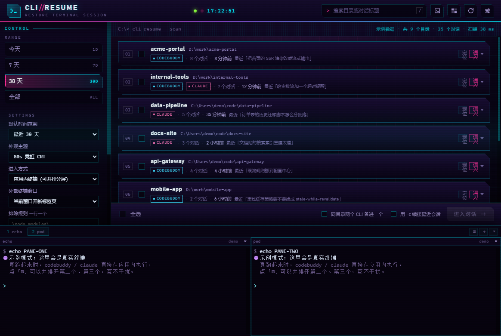
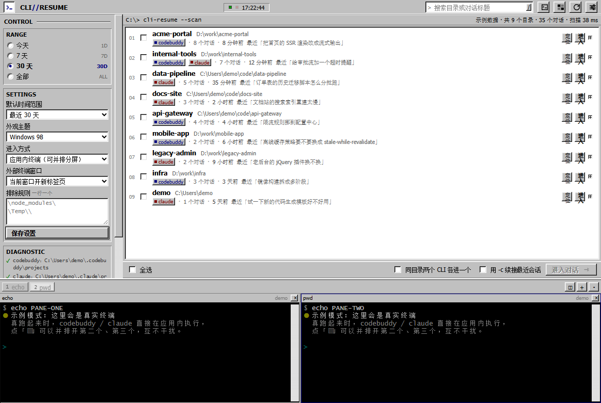

## 全文搜索

列表上方那个搜索框默认只过滤目录名和对话标题。**敲回车**才去会话正文里翻 ——
「上次那个 hydration 报错是在哪问的」，凭记忆搜一句话比翻目录快得多。

命中按会话分组显示，每条留前后文并高亮关键词，左右标出是「你」说的还是「答」的；
点任意一行直接进那个会话。搜索的范围是全部历史，不受上面「今天 / 7 天 / 30 天」限制。

索引在本地后台建：`desktop/src/search.cpp` 把每份 jsonl 的正文抽出来，一个会话一个索引文件，
落在 `%LOCALAPPDATA%\CliResumeGui\search\`。源文件 mtime 和大小没变就不再重读，
所以除第一次要通读一遍（这台机器上 200 个会话约 6 秒），之后启动几乎不花时间，查一次 2~3 ms。

- 只收人说的话和助手的回答；`tool_result`（整屏命令输出）不进索引，那部分占了文件体积的大头又搜不出东西
- 单条消息留 700 字、单个会话留 1.5MB：长会话后面会被截断，保留的通常是事情的起因，更值得搜
- 子代理的旁支对话（`isSidechain`）跳过，否则一个词能搜出十几条重复

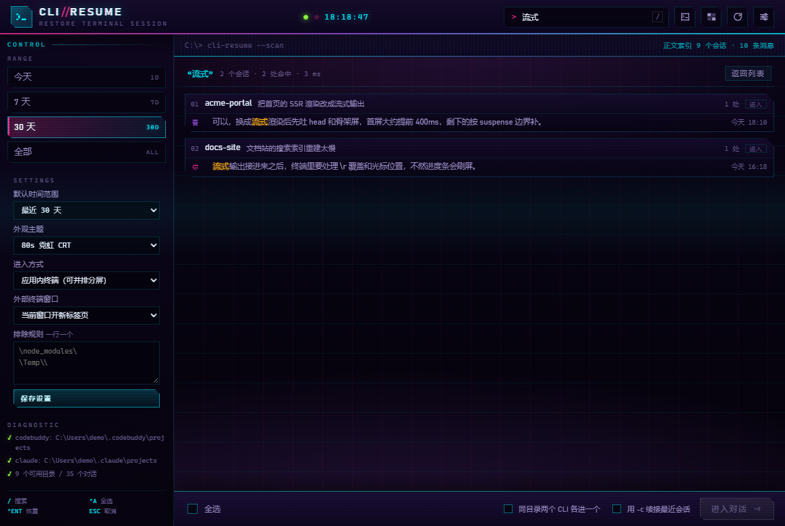
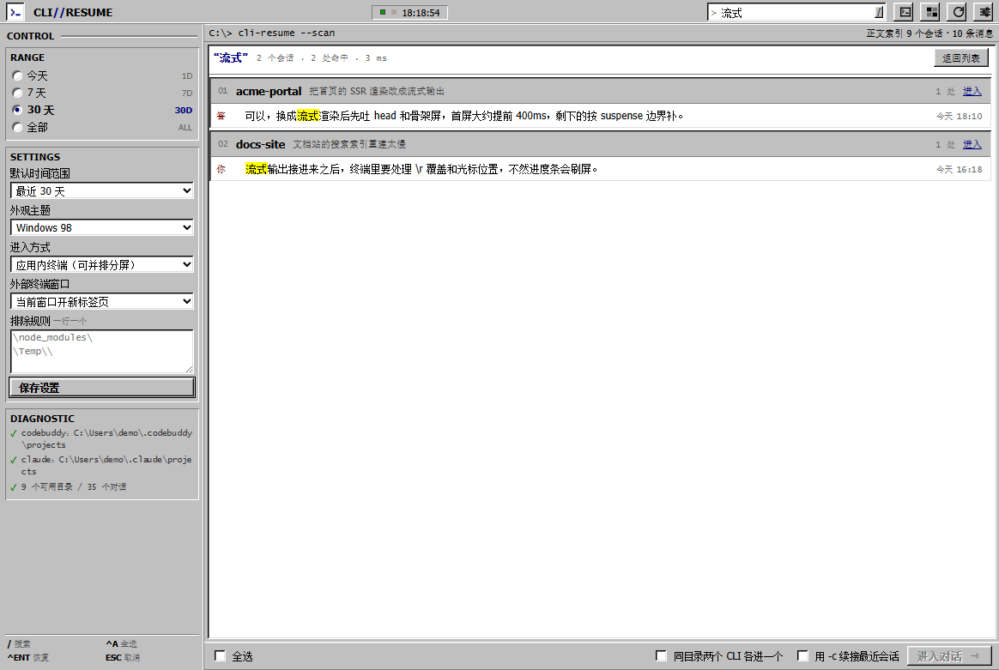

## 导出与用量

会话行右侧的「导出」把一次对话还原成 Markdown：标题、目录、时间范围、逐轮问答，
工具调用收成引用行。文件落在 `文档\cli-resume\`，拿标题当文件名，重名自动加序号。
搜索索引为了省内存把正文截到 700 字，导出走的是源 jsonl，全文都在。

顶栏那个柱状图按钮是 token 统计：7 / 30 / 90 天，输入、输出、缓存读分开记，
按模型和「最费 token 的会话」排行。用量是建索引时顺带抽出来的，打开就是结果，不重扫历史。

成本只对查得到公开单价的模型估算（Claude 系），kimi / deepseek 这类订阅制模型只统计 token，
表里显示「—」—— 编一个看似精确的数字比不显示更糟。

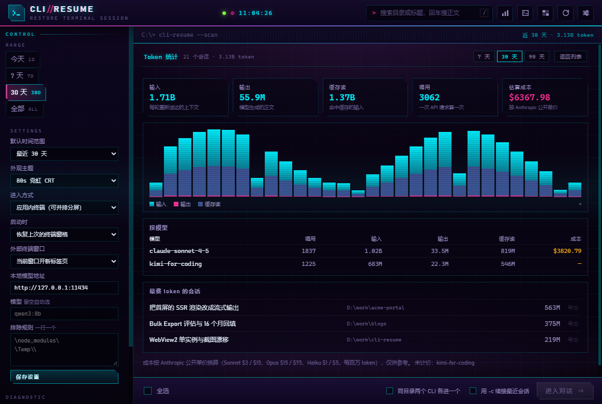
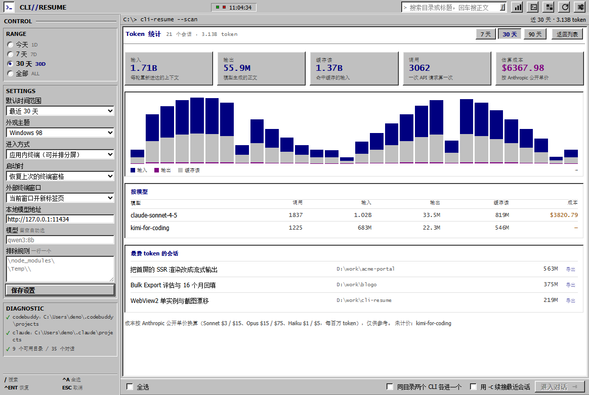

## 本地模型复盘

每张目录卡片多了个「复盘」：把最近一次会话的头尾交给本机模型，回三行 —— **做了 / 卡在 / 下一步**。
早上打开电脑，不用通读几十条记录就知道昨天停在哪。数据不出机器。

不用另外装框架：Ollama 的原生接口和任何 OpenAI 兼容服务（LM Studio、vLLM）都认，
地址填进左栏，模型留空就自动挑。模型没起来时不装死 —— 照样列出最后几条原始记录，
先把「上次在做什么」看明白，再去启动模型。

摘要按会话文件缓存，文件没变就直接用，不重复推理。

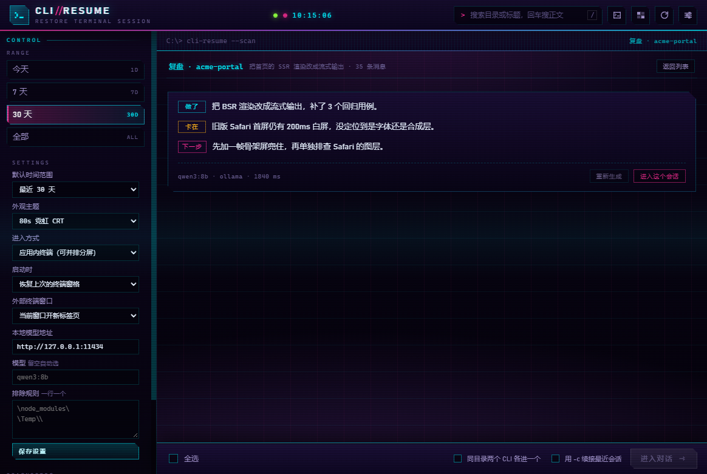
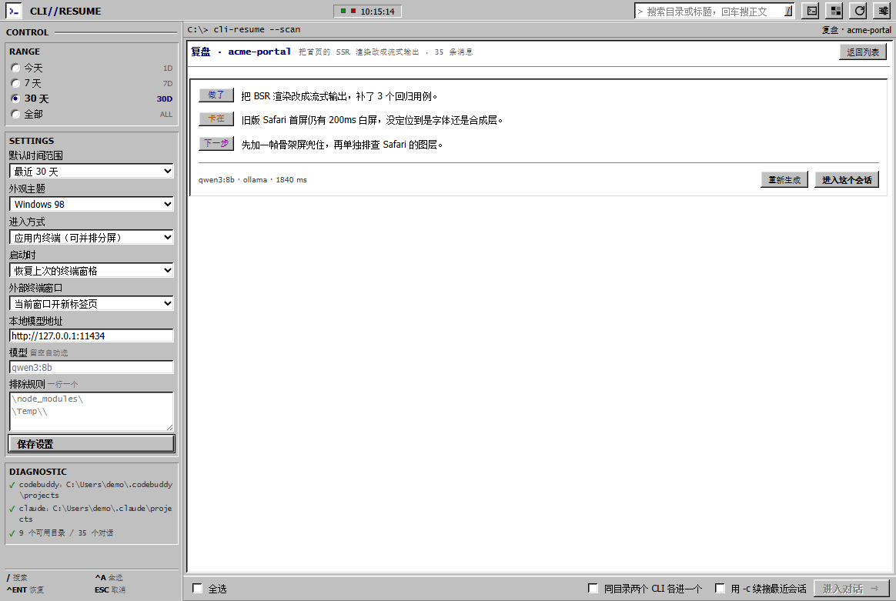

## 它怎么知道你在哪些目录干过活

两套 CLI 都把会话落在 `%USERPROFILE%` 下，格式还一样（jsonl，每条消息带 `cwd` 和 `sessionId`）：

```
~/.codebuddy/projects/<编码目录>/<sessionId>.jsonl
~/.claude/projects/<编码目录>/<sessionId>.jsonl
```

- **codebuddy**：目录名编码不可逆（非字母数字全变 `-`），所以直接从 jsonl 里读 `cwd`。
  只读文件头 64KB —— 最大的会话有 4MB，全读没必要。
- **claude**：jsonl 不一定带 `cwd`，改用 `~/.claude.json` 里的 `projects` 键（真实绝对路径）
  反算编码去对表，对不上的再退回嗅探。
- 文件 **mtime** 当最后活跃时间。目录已经被删掉的会话直接跳过，不会拉起一个不存在的路径。
- 桌面端还会从 jsonl 尾部读 `ai-title` 记录（模型给会话起的标题），老会话没有就退回首条用户消息。

## 三个坑

**`.cmd` 里不能写 UTF-8 中文。** cmd.exe 按当前代码页（GBK）解析批处理文件，
UTF-8 中文字节会被解成乱码，其中某些字节还能把后面的换行吃掉，导致下一行命令被拼进去，
报 `'...node' 不是内部或外部命令`。所以 `cr.cmd` 全 ASCII，注释也用英文。

**命令里不能带分号。** `wt` 会把整个命令行里任何位置的 `;` 当标签分隔符，哪怕它在
`-Command` 的引号里。实测 `powershell -Command "pwd; codebuddy --version"`，后半段会被切掉变成新标签。

**`--resume` 必须在会话原本的 cwd 里跑。** 每个标签的 `-d` 要精确对应扫出来的 `cwd`，
不能用当前目录凑合，否则 CLI 找不到那条会话。

## 边界

- 只支持 Windows，终端用 Windows Terminal（`wt.exe`）。没有 `wt` 就没有标签页这一说。
- 完整支持 `codebuddy`、`claude`、`codex` 三套历史格式；Kimi / Qoder / Qwen Code 只检测数量。
  别家 CLI 的落盘格式变了就得跟着改。
- **能不能真续上，取决于 CLI 自己的鉴权状态。** 工具只负责把正确的命令和正确的目录递过去；
  没登录、模型配置不认，终端里照样会报错。好在标签用 `-NoExit` 打开，报错留在窗口里不会闪退。
- 扫描是同步的，几千个会话时会慢。目前 70 多条对话的量级，扫描 30ms 上下。

## 许可

[MIT](LICENSE)
