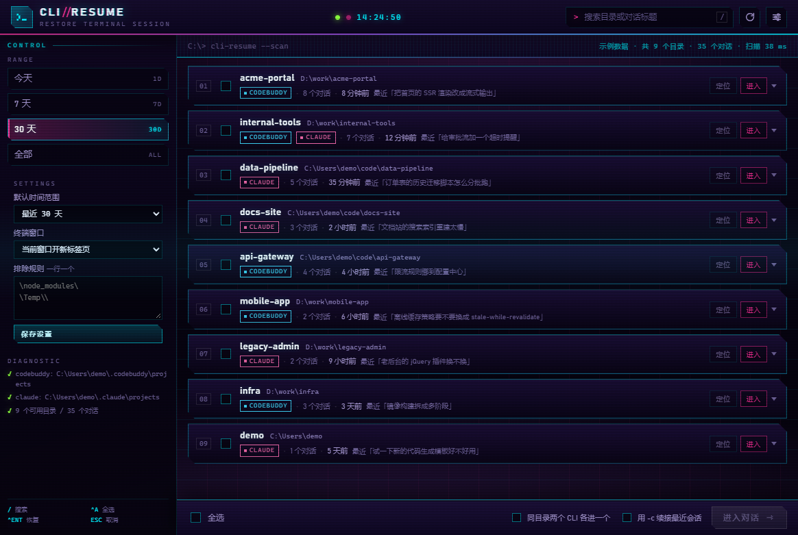
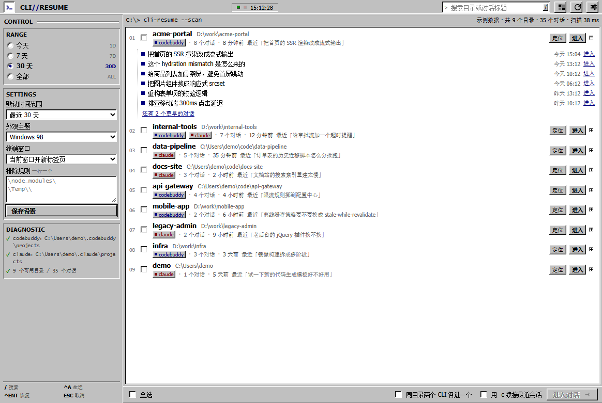
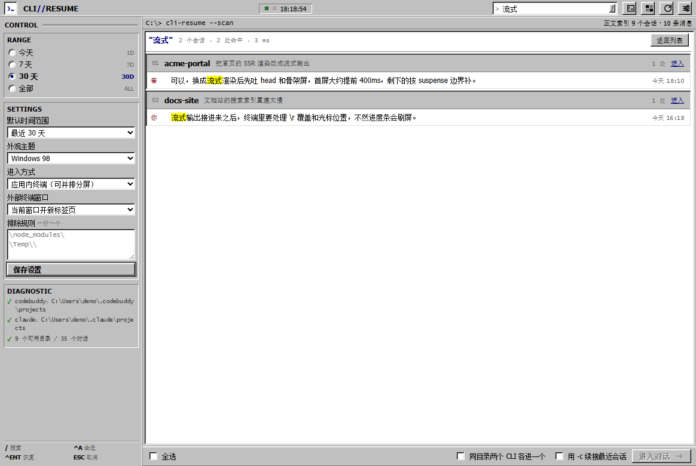
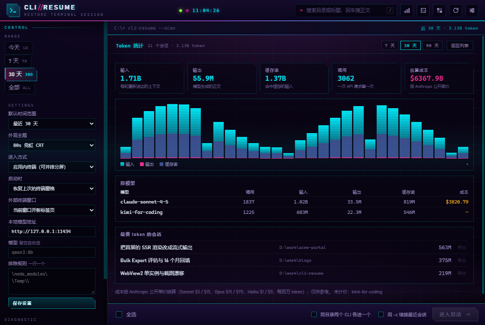
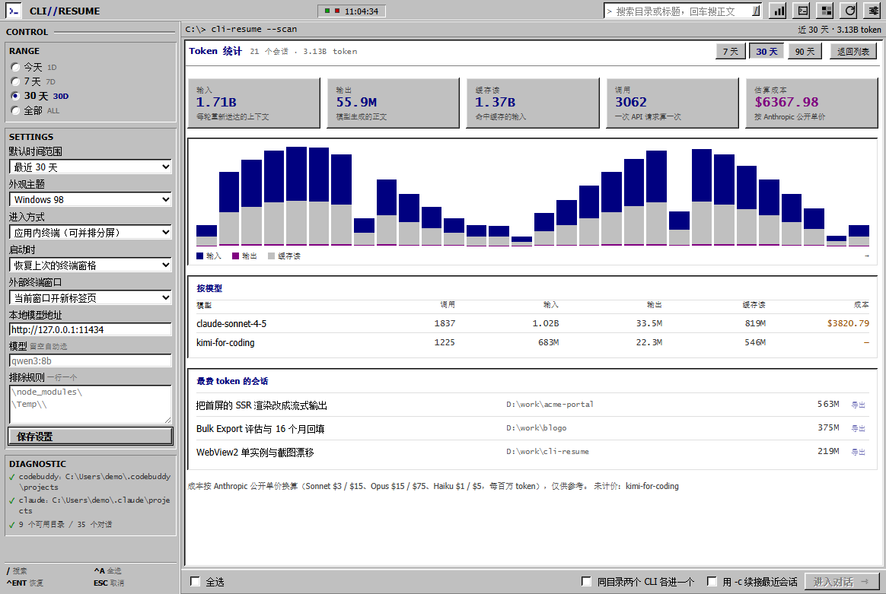
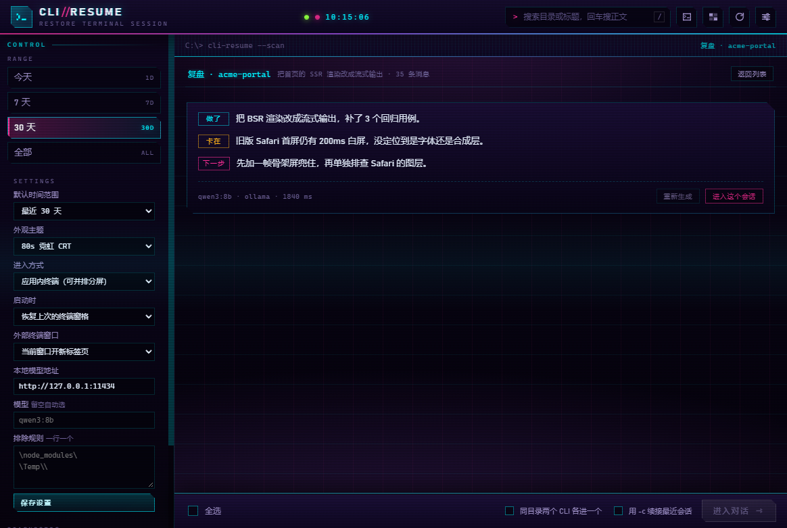
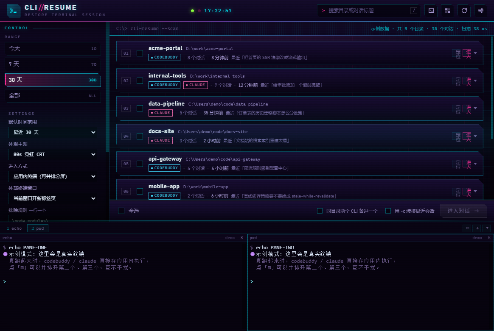

# cli-resume（桌面端）

重启后不知道上次在哪几个项目干活、每个目录聊到哪了 —— 这个窗口把现场摊开给你看，
点一行就进那一条对话。

界面有两套皮肤，共用同一份布局：

- **80s 霓虹 CRT**（默认）：紫黑底、青与品红双霓虹、CRT 扫描线、网格地平线、录像带式的色散字标
- **Windows 98**：`#c0c0c0` 灰面板、四层 1px 立体线、深蓝选中行、宋体小字、16px 经典滚动条

顶栏那个四格图标点一下换一套，左栏「外观主题」也能选；选择写进 `settings.json`，下次启动直接是上次那套。




不是套一层配色——布局也跟着主题改过：顶栏、左栏常驻控制台、主屏幕、操作台。

## 和命令行版的区别

命令行版按「工作区」恢复：每个目录开一个标签，进去的是这个目录最近那一条会话。

桌面端多两层信息：

- **每个目录下的所有对话都列出来**，带模型生成的标题和时间，不用回忆「上次那个是第几个」。
- **点具体某一条**，直接 `--resume` 到那条会话，而不是该目录最近的那条。

引擎其实是两套：命令行版是 Node，桌面端是 C++，都直接读同样的 jsonl 历史，互不依赖。

## 编译

需要：

- Windows 10/11
- Visual Studio 2022 的 C++ 工具链（提供 `vcvars64.bat`）
- WebView2 SDK（**不随仓库分发**，见下）
- Python 3 + Pillow，只在重新生成图标时需要

### WebView2 SDK

从 NuGet 拿 [`Microsoft.Web.WebView2`](https://www.nuget.org/packages/Microsoft.Web.WebView2)
（`.nupkg` 就是个 zip，改后缀解开），取这两样放进 `third_party\`：

```
third_party\webview2\include\WebView2.h
third_party\webview2\include\WebView2EnvironmentOptions.h
third_party\webview2\lib\x64\WebView2LoaderStatic.lib
```

包里的原始位置是 `build\native\include\*` 和 `build\native\x64\WebView2LoaderStatic.lib`。

用静态 Loader 是为了让 exe 不依赖 `WebView2Loader.dll`，复制到别的机器直接能跑。
运行时仍然需要系统里装了 **WebView2 Runtime** —— Win11 自带，Win10 一般也已被 Edge 装上了。

### 编译

```bat
build.bat
```

产物 `bin\cli-resume.exe`，界面文件会被复制到 `bin\web\`。改完 `web\` 里的东西重跑一次就同步了。

`build.bat` 里 `VCVARS` 写死的是 Community 版路径，装的是 Professional / Enterprise 就改那一行。

## 运行

```
bin\cli-resume.exe                     正常启动
bin\cli-resume.exe --demo              用内置示例数据，不扫本机历史（看界面用）
bin\cli-resume.exe --demo --skin win98 示例模式直接用某套皮肤进（neon | win98）
bin\cli-resume.exe --shot a.png --wait 2500        截图后退出（调试用）
bin\cli-resume.exe --demo --ui settings --shot a.png   高亮设置区再截图
bin\cli-resume.exe --demo --ui expand --shot a.png     展开第一个目录再截图
bin\cli-resume.exe --ui enter --shot a.png             展开并点进第一条（会真的开终端）
```

`--ui` 可以逗号串多个动作，按 280ms 间隔依次执行，例如
`--ui theme,expand`、`--ui theme,settings`。

`--demo` 加 `#demo` 到页面地址，前端 `demo.js` 检测到就改用内置假数据，
并且把「进入」「定位」「保存设置」都拦成提示，不会真的拉起终端。

装好命令行版之后 `cr gui` 也能直接拉起这个窗口。

## 界面上的东西

窗口切成三块，不是常见的「顶栏 + 列表 + 抽屉」：

- **顶栏**：机身铭牌（`CLI//RESUME`）、电源与活动指示灯、时钟、搜索框，右侧一排按钮：
  token 统计、内嵌终端、换皮肤、重新扫描
- **左栏（常驻控制台）**：时间范围、设置、环境自检、快捷键提示。设置原来是从右侧滑出来的抽屉，
  现在一直开着——排除规则和环境自检随时能看到，不用先点开一层
- **主屏幕**：命令行样式的标题栏 + 目录卡片列表 + 底部操作台

列表里的操作：

- **时间范围**：今天 / 7 天 / 30 天 / 全部，默认 30 天，选了会记住
- **搜索**：默认按目录名、完整路径、对话标题过滤，`/` 聚焦；**回车**改成去会话正文里全文搜
  （详见下面的「全文搜索」）
- **卡片**：序号 + 项目名 + 完整路径 + 用过的 CLI 标签 + 对话数量 + 最后活跃时间 + 最近那条对话的标题
- **展开**：点卡片任意位置（勾选框除外）展开这个目录下的对话列表，按时间倒序，先显示 6 条
- **进入**：点对话行（或卡片上的「进入」按钮走最近那条），直接在应用内终端里 `--resume` 那条会话；
  默认走内嵌终端，左栏「进入方式」可以切回外部终端窗口
- **复盘**：卡片上的「复盘」把最近一次会话交给本机模型，回「做了 / 卡在 / 下一步」（详见下面的「本地模型复盘」）
- **窗口**：把这个目录单独开一扇窗，只列它自己的会话（详见下面的「多窗口与托盘」）
- **导出**：会话行右侧的「导出」把这次对话写成 Markdown，落在 `文档\cli-resume\`（详见下面的「导出与统计」）
- **定位**：在资源管理器里打开这个目录




快捷键：`/` 搜索、`Ctrl+A` 全选、`Ctrl+Enter` 恢复、`Esc` 取消搜索或高亮。

**全局热键 `Ctrl+Shift+Space`**：任何程序里按都能把窗口拉到前台并把光标放进搜索框，
再按一次收起（`main.cpp` 里 `RegisterHotKey`，`WM_HOTKEY` 负责切换）。被别的程序占用时
只记一行日志，不影响启动。**点 × 不是退出**，是收进托盘；真退出走托盘右键菜单。

顶栏右侧的四格方块按钮一键换皮肤，左栏「外观主题」下拉是同一个设置，改完立即生效并落盘。

左栏设置区能改默认时间范围、外观主题、进入方式（应用内终端 / 外部窗口）、启动时是否恢复上次的窗格、
外部终端窗口行为（复用当前窗口 / 强制新窗口）、本地模型地址与模型名、排除规则；
改完点「保存设置」落到 `settings.json`。


## 多窗口与托盘

### 一扇窗 = 一个工作区

卡片上的「窗口」调 `POST /api/window/new`：先按窗口类名找有没有已经开着的那扇，
有就 `SetForegroundWindow`，没有才 `CreateProcess` 起一个新进程：

```
cli-resume.exe --win <slug> --only "D:\AI	mux-windows"
```

`slug` 是目录小写后的 FNV-1a 短哈希，所以同一个目录永远落到同一扇窗。窗口类名是
`CliResumeWin_<slug>`，既用来查重，也让任务栏里两扇窗互不干扰。

**每个窗口是一个独立进程**，不是同一进程里的第二个 WebView2：

- WebView2 的 user data 目录只能被一个进程持有，第二个控制器会直接创建失败
- 搜索索引是按需重写的文件，两个进程同时扫同一份索引会互相截断
- 每个窗口用 `data\WebView2-<slug>` 和 `%LOCALAPPDATA%\CliResumeGui\win-<slug>\`，
  搜索、摘要缓存、终端布局都各存一份；`settings.json` 仍然共用

代价是每扇窗启动时各自建一次索引（本机约 6 秒）。换来的是互不写坏，以及关掉主窗口
不影响工作区窗口。

### 托盘与开机自启

`Shell_NotifyIconW` 挂一个图标，菜单三项：显示/隐藏、开机自启（打勾就是已开）、退出。

- **点 × 收进托盘**，不退出：这是个随时要唤醒的工具，关掉再等 6 秒重建索引不划算。
  `--shot` 截图模式例外，必须真的退出，否则截图完进程不走
- 第一次收起会弹一个气泡，告诉你 Ctrl+Shift+Space 和右键菜单
- 资源管理器重启后托盘图标会消失，监听 `TaskbarCreated` 补一个
- 开机自启只写 `HKCU\Software\Microsoft\Windows\CurrentVersion\Run`，值是
  `"<exe>" --tray`；`--tray` 启动时不显示窗口，只在托盘待命

全局热键只注册在主窗口：热键是系统级独占资源，工作区窗口再注册会失败（日志里能看到
`hotkey ... failed`），也没必要——热键拉起主窗口就够。

## 怎么定位会话的

```
~/.codebuddy/projects/<编码目录>/<sessionId>.jsonl
~/.claude/projects/<编码目录>/<sessionId>.jsonl
```

- **codebuddy**：目录名编码不可逆（非字母数字全变 `-`），只能从 jsonl 里读 `cwd`。
  只读文件头 64KB —— 最大的会话有 4MB。
- **claude**：jsonl 不一定带 `cwd`，用 `~/.claude.json` 的 `projects` 键反算编码对表。
- 路径统一成小写 + 反斜杠再归并，否则 `D:/ai/x` 和 `d:\ai\x` 会变成两张卡片。
- 目录不存在的会话直接丢掉，避免拉起一个空路径。

扫描结果是缓存过的，`/api/scan?refresh=1` 强制重扫。20 个目录 / 74 条对话大约 30ms。

## 对话标题是怎么来的

会话跑过几轮之后，CLI 自己会往 jsonl 里写一条 `{"type":"ai-title","aiTitle":"…"}`，
这就是模型给这段对话起的名字。桌面端只读文件**尾部 32KB** 找它，找不到就：

1. 退回去找第一条 `type == "user"` 的消息，取开头几十个字；
2. 整条会话没有一句人话（点开就退出来那种空壳），直接不显示。

清洗规则有两个：标题首字符是 `<` 的跳过（那是 `system-reminder` 之类的注入块，不是人写的）；
按**码点**截断而不是按字节，否则会把汉字切成半个乱码。

## 主题是怎么组织的

`style.css` 只写结构（栅格、尺寸、层级），造型全在皮肤里，一共四套：

| 皮肤 | 文件 | 造型语言 |
|---|---|---|
| 80s 霓虹 CRT | `style.css` 的 `:root` | 紫黑底、青/品红双霓虹、扫描线、辉光 |
| 70s 琥珀终端 | `theme-amber.css` | 单色 P3 橙黄，只有亮度层次；等宽字体、无圆角 |
| Windows 98 | `theme-win98.css` | 四层 1px 立体线、无渐变、宋体点阵字 |
| Windows XP Luna | `theme-xp.css` | 1px 边框 + 竖向渐变 + 3px 圆角、蓝标题栏、米黄客户区 |

每套都用 `html[data-skin="…"]` 前缀成组覆盖，`style.css` 一条没改。

**半透明色也走变量。** 霓虹那边有 100 多处以 `rgba(0, 240, 255, .18)` 形式写死的边框、光晕、
阴影，直接改色会漏一大片。所以 `:root` 里额外放了五个 RGB 通道（`--cyan-rgb` 等），
样式统一写 `rgba(var(--cyan-rgb), .18)`；琥珀皮肤只要把通道改成 `255, 176, 0`，
整屏就变橙，不用逐条覆盖。

XP 那套是直接从 98 的文件派生的：选择器、尺寸、栅格完全一样，只把「四层硬立体线」换成
「1px 边框 + 竖向渐变 + 圆角」，所以 `theme-xp.css` 里前半段是 98 的规则、后半段是
「Luna 造型层」，同特异性写在后面覆盖。

98 那套九成的立体感来自下面两个变量，文件里反复引用：

```css
--raise:  inset -1px -1px #0a0a0a, inset 1px 1px #ffffff, inset -2px -2px #808080, inset 2px 2px #dfdfdf;
--sunken: inset -1px -1px #ffffff, inset 1px 1px #0a0a0a, inset -2px -2px #dfdfdf, inset 2px 2px #808080;
```

记住方向就够：**凸起是左上亮、右下暗，凹陷反过来**，中间夹一圈过渡灰。按钮、输入框、
分组框、滚动条滑块、勾选框全是这两条的组合。分组框那种「刻进去一道」的凹刻是
`inset 1px 1px 暗 + inset -1px -1px 亮`，方向与凸起相反。

加第五套皮肤不用碰 `style.css`：新建 `theme-xxx.css`，规则都用 `html[data-skin="xxx"]` 开头，
在 `index.html` 里引一下，再往 `app.js` 的 `SKINS` / `TERM_THEMES` 里加个名字即可。

## 实现上踩到的坑

**`bind_to_port` 之后必须用 `listen_after_bind`。** cpp-httplib 里 `listen(host, port)` 内部会
再 bind 一次，此时端口已被自己占着，直接返回 false —— 端口看着是占上了，但根本没有 accept 循环，
WebView2 一路重试到 60 秒超时才放弃，页面一片空白。换成 `listen_after_bind()` 之后加载降到 1 秒内。

**WebView2 的 user data 目录只能被一个进程持有。** 重复启动会直接在创建控制器那步失败，
报 `-2147024726`（ERROR_BUSY）。所以用一个命名互斥量 `Local\CliResumeGui_SingleInstance` 挡掉，
第二次启动只是把已有窗口带到前台。

**`wt` 会把命令里任何位置的 `;` 当标签分隔符**，哪怕在 `-Command` 的引号里。
所以拼 `--resume` 命令时绝对不能出现分号。

**参数转义要按 `CommandLineToArgvW` 的规则来。** 路径带空格时给参数加引号，
引号前面的反斜杠要成对翻倍，不然 Powershell 收到的是半个参数。

**终端工具栏的按钮样式没有作用域。** `style.css` 里给终端工具条写的 `.mini-btn { width: 20px }`
是全局选择器，卡片上的「定位 / 进入」也匹配它，结果一直显示成 20px 宽、文字竖排的方块
（截图里看久了以为是设计）。把那条规则收进 `.term-tools .mini-btn` 才修好 —— 写组件样式时
宁可多一层选择器，也别让 `width` 这种硬属性落在公共类上。

**换皮肤要连窗口底色一起换。** Win32 窗口的 `hbrBackground` 在 WebView2 首帧之前就已经画上去了，
底色不对启动会闪一下。所以 `main.cpp` 先问后端当前主题，霓虹用 `RGB(5, 2, 11)`、
98 用 `RGB(192, 192, 192)`。

**首帧还会闪一下另一套皮肤。** 主题的真相在 `settings.json`，要等一次网络往返才知道，
所以设置之前页面就已经按默认主题画出来了。解法是在 `<head>` 里用 `localStorage` 存一份上次的值
先摆上 `data-skin`，拿到设置后再纠正——只为一帧，但每次启动都看得到。

**CSS 类复用会把新组件压变形。** 终端工具栏的 `.mini-btn` 是固定的 20×18 方钮，
搜索结果顶部的「返回列表」也用了这个类，于是文字被挤成竖排。同一批 `.mini-btn` 在
`style.css` 里出现两次（卡片区和终端区），后来那组把 `width` 写死了 —— 靠
`.deep-head .mini-btn` 提特异性才压回来。新加组件时尽量别复用餐具尺寸写死的类。

**`--skin` 一开始只在示例模式下生效。** 它是拼在 URL 的 hash 上的（`#demo&skin=win98`），
非示例模式没有 `#`，`&skin=` 就成了路径的一部分。改成判断是否已有 `#` 再决定用
`#skin=` 还是 `&skin=`，`app.js` 侧用 `location.hash` 里的 `skin=` 强制皮肤，且不写回配置
（截图不该改用户自己的主题）。

## 全文搜索

搜索框按回车 → `GET /api/search?q=` → 后端在自己维护的正文索引里做子串匹配，
结果按会话分组返回，前端每行拆成 `before / hit / after` 三段渲染，避免为了画一个 `<mark>`
去按字节切 UTF-8。

索引（`src/search.cpp`）：

- 一个会话一个索引文件，落在 `%LOCALAPPDATA%\CliResumeGui\search\`。首行是元信息
  （cwd、标题、源文件的 mtime 和大小），之后每行一条消息
- 启动时后台线程先读回索引，再扫两个 `projects` 目录；源文件 mtime + size 没变就跳过，
  变了只重写那一个文件。200 个会话首次 6 秒左右，之后基本是 0
- 只索引 `text / input_text / output_text` 块；`tool_use` 存工具名加 180 字参数开头；
  `tool_result` 直接丢（整屏命令回显，占体积又搜不出东西）
- 单条留 700 字、单会话留 1.5MB / 5000 条：长会话截断，前面通常是事情的起因
- 查询时把 needle 折成小写，haystack 逐字符折——中文不受影响，`WebView2` / `webview2` 等价
- 内存里只放正文（本机 200 个会话约 3MB），查一次 2~3 ms；进程常驻 28MB 左右




## 导出与统计

### 导出 Markdown

会话行右侧的「导出」→ `POST /api/export` → `src/exportmd.cpp` 重读源 jsonl，
拼成一份能直接读的稿子：标题、目录、会话 id、时间范围、逐轮问答，工具调用收成引用行。
输出到 `文档\cli-resume\<标题>-YYYYMMDD-HHMM.md`，重名自动加 `-2`。

- **不读索引**：索引按搜索需要把每条消息截到 700 字，导出要全文
- **claude 的一条回复会被拆成多行写**（thinking / text / tool_use 各一行，`message.id` 相同），
  按 id 合并成一段；只有工具调用、没有正文的片段也并进上一条，
  否则稿子里全是孤零零的「## 助手」
- 工具调用渲染成 `> 工具 \`Bash\`：\`{...}\``，参数截 300 字、反引号换成单引号
- 子代理的旁支（`isSidechain`）和 `<system-reminder>` 这类注入内容不导出

### Token 统计

建立搜索索引时顺手把每行的 usage 抽出来，按「本地日期 + 模型」分桶写进索引（v3）。
`/api/stats?days=` 只做汇总，200 个会话几毫秒，不用再读 300MB 源文件。

两个必须处理的坑：

- **claude 同一条消息写多行、每行带同一份 usage**，不去重会几乎翻倍。按 `message.id` 去重
- **codebuddy 新版同时有 `message.usage` 和 `providerData.rawUsage`，模型名只在后者里**。
  优先取 `rawUsage`，否则统计表里全是 `unknown` —— 这也是索引从 v2 提到 v3 的原因

成本只内置 Anthropic 公开价（每百万 token，按模型名里的 `opus` / `sonnet` / `haiku` 匹配）。
kimi-for-coding、deepseek、k3 这些是订阅制或没有按量价，只统计 token，成本列显示「—」。
本机 30 天的实际数据是 6.3B token，其中输入占大头 —— 每一步都把完整上下文重发一遍，
这个数字比「以为自己在花多少钱」更有参考价值。




## 本地模型复盘

卡片上的「复盘」把最近一次会话喂给本机模型，产出三行：**做了 / 卡在 / 下一步**。
数据不出机器，也不用额外装框架。

```
点击「复盘」
  → GET /api/summary?tool=&sid=
  → SearchIndex::digest(tool, sid, 2, 26)      索引里取开头 2 条 + 最近 26 条
  → Summarizer::summarize()                    探测协议 → 组提示词 → 调模型 → 写缓存
  → { text, model, turns, llmOk, cached, elapsedMs }
```

**素材取自索引，不重读源文件。** `search.cpp` 建索引时已经把正文抽好、把 `tool_result`
这种整屏输出丢掉了，正好是复盘想要的东西；源文件没变就直接信索引，省一次 300MB 的读取。

**提示词只要求三行**，并且带 `/no_think`：qwen3 默认先想一段再答，关掉之后 8B 在 3060 上
两三秒就能回，还省得把思考过程混进结果（真出现了也会被 `stripThink` 摘掉）。

**协议自动探测。** 先打 `/api/tags`（Ollama），再打 `/v1/models`（OpenAI 兼容）。
两台机器上分别装过 Ollama 和 LM Studio，端口和协议都不一样，与其在设置里让用户选，
不如自己问一遍。结果缓存 20 秒，点「重新生成」时强制重探。模型名留空就自动挑，优先 qwen 系。

**缓存按会话文件走。** `summary/<tool>_<sid>.json` 里存 `mtime + size + model + 提示词版本`，
四样任一不符就重新生成。同一会话第二次是 0 ms，换个模型也会重算。

**模型不可用时不装死。** 接口仍然返回 200 和最后 8 条原始记录（`turns`），前端渲染成
「本地模型没连上 + 最近几条」。这样没起模型也能看出上次停在哪，而不是只有一个红叉。
调用本身串行（`callMu_`），避免两个窗口同时把一份 8B 模型压进显存。




## 内嵌终端

会话不再必须弹外部窗口。`src/terminal.cpp` 用 ConPTY 起一个真 shell，`web/vendor/xterm.js` 负责画，
中间是一条 WebSocket（`/api/term/ws?id=…`）。二进制帧就是 PTY 的原始字节（两个方向都是），
文本帧只放控制消息，目前只有一个 `resize`。

流程：

1. `POST /api/term/open` 带 `cwd` / `cmd` / `cols` / `rows` → 后端 `CreatePseudoConsole` + 起 shell，
   返回会话 id（shell 起来后通过 PTY 把 `cmd` 当键盘输入灌进去，所以能看到提示符和命令回显）
2. 前端拿 id 连 `ws://…/api/term/ws?id=`，先收 backlog（启动 banner + 提示符），之后实时推
3. 窗口尺寸变化 → `fit()` 算出行列 → 通过 WS 发 `resize`，后端调 `ResizePseudoConsole`
4. 关窗格 / 退出应用 → WS 断开 → 后端 `ClosePseudoConsole`，子进程挂在 job object 上一起回收

一个窗格一个 `Terminal` 实例，面板里用 CSS grid 排：1 个占满、2 个并排、3~4 个两行两列。
高度拖 `.term-drag`，收起只是 `flex-basis: 0`，会话还在。




### 布局恢复

开着哪几个窗格、各自在哪个目录、面板多高、当前是第几个标签，存在
`%LOCALAPPDATA%\CliResumeGui\layout.json`，下次启动原样铺回来。单独一个文件而不是塞进
`settings.json`：每开/关一个窗格都要写一次，和「用户点保存」才变的设置不是一回事。

```json
{"visible":true,"height":242,"active":0,
 "panes":[{"cwd":"d:\\ai\\x","cmd":"claude --resume 0229…","title":"GSC 数据分析","tool":"claude","sessionId":"0229…"}]}
```

存的是**启动命令**而不是会话 id，因为「怎么起来」本来就已经编码在命令里了：
`claude --resume xxx`、`codebuddy --resume xxx`、开了 `useContinue` 的裸 `codebuddy`、
手开的空 shell —— 四种情况一条 `cmd` 全都覆盖，恢复逻辑不用分叉。

两个刻意的取舍：

- **收起状态不恢复。** 上次点了「▾」收起就退出，这次不拉起任何窗格。否则启动时会多出
  几个看不见的 CLI 进程：用户既没看见也没法操作，白占内存。
- **恢复期间不写盘。** 每加一个窗格都会触发保存，那时 panes 还不齐，写下去会把布局截断成
  「只剩一个」。用一个 `TM.restoring` 标志挡住，铺完再写一次归一化后的状态。

高度按视口 70% 夹一下，换了更小的屏幕不会把上面的列表挤没。左栏「启动时」可以整体关掉。

### ConPTY 的坑

**`STARTF_USESTDHANDLES` 必须显式设置，且三个句柄置空。**
不设这一组，子进程会继承宿主进程的标准句柄 —— shell 的 banner 和提示符直接写进宿主自己的 stdout，
伪终端这边一个字节都收不到，表现是「进程活着、CPU 也不高、就是不说话」。这一条查了很久，
最后是逐行比对 node-pty 的 `conpty.cc` 才定位到。

**`UpdateProcThreadAttribute` 传的是 HPCON 值本身，不是 `&hpc`。** 传地址的话系统会把指针当句柄，
子进程挂不上伪终端（传一个假句柄会直接崩在 `CreateProcess` 里，可以拿这个特征自检）。

**交给 ConPTY 的那对句柄要在 `CreateProcess` 之后再关。** 早关会让伪终端认为终端已经走了。

**管道用 `CreatePipe` 就够**，不需要 node-pty 那套命名管道 + `ConnectNamedPipe`。

**缓存不能只留最后一次输出。** shell 启动瞬间会连着吐好几段（清屏、填充空行、设标题），
WS 连上之前这些都在后端攒着，重连后要一次性补发，否则终端打开是黑的。

## 图标

`assets\icon.svg` 是源文件（160×160 网格），`assets\icon.ico` 由 `python assets\make_icon.py`
生成，再经 `src\app.rc` 编进 exe。

配色跟界面同源：紫黑底板、青色窗口描边、品红提示符、琥珀光标。

ico 一共 7 帧：16 / 24 用 `icon-small.svg` 那套画法（去掉后层卡片、线宽加到 9），32 以上用完整版。
细线框缩到 24px 以下会糊成一团。Pillow 的 ico 写入器只能用一张图缩放，混合两套得手拼，脚本里
`build_ico()` 干的就是这件事。

## 边界

- 只支持 Windows。内嵌终端依赖 ConPTY（Windows 10 1809 及以上）；选「外部终端」时才需要
  装 Windows Terminal。
- 只认 codebuddy / claude 两套历史格式。
- 扫描是同步的，上千个会话会开始卡；目前量级够用。
- 复盘要有一个本机模型在跑（Ollama / LM Studio / 任何 OpenAI 兼容服务）。没有也能用，
  只是退回「最近几条原文」，不会自动帮你装模型。
- **能不能真续上取决于 CLI 自己的鉴权状态**，工具只负责把命令和目录递对。
