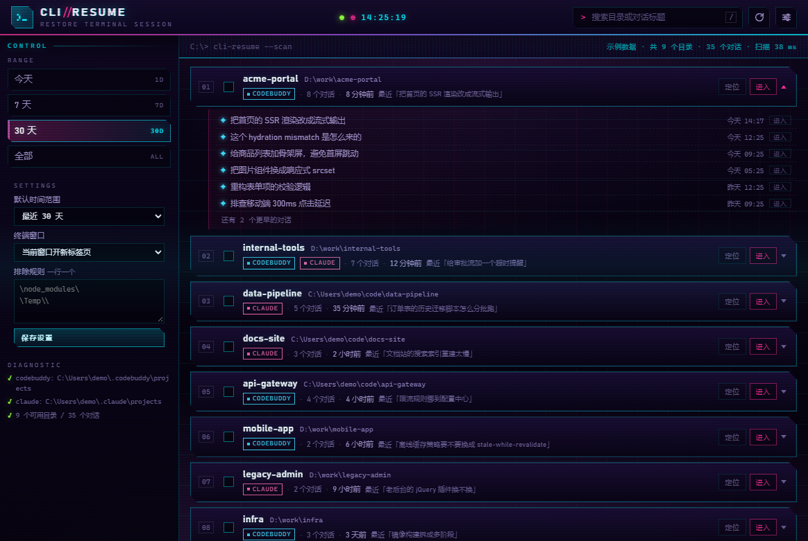
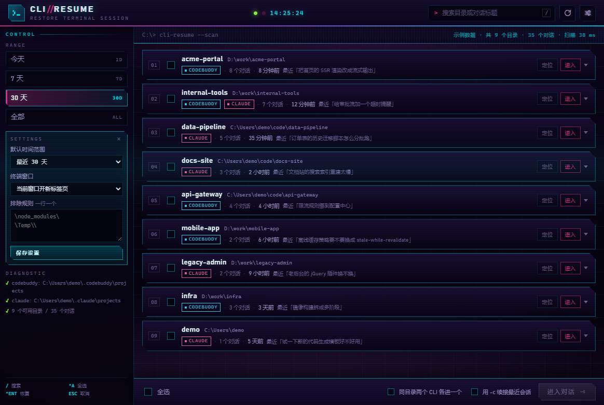

# cli-resume（桌面端）

重启后不知道上次在哪几个项目干活、每个目录聊到哪了 —— 这个窗口把现场摊开给你看，
点一行就进那一条对话。

界面是 80 年代合成器浪潮那套语言：紫黑底、青与品红双霓虹、CRT 扫描线、
底部网格地平线，标题用录像带式的色散效果。不是套一层主题皮肤——布局也跟着改了。


## 和命令行版的区别

命令行版按「工作区」恢复：每个目录开一个标签，进去的是这个目录最近那一条会话。

桌面端多两层信息：

- **每个目录下的所有对话都列出来**，带模型生成的标题和时间，不用回忆「上次那个是第几个」。
- **点具体某一条**，直接 `--resume` 到那条会话，而不是该目录最近的那条。

引擎其实是两套：命令行版是 Node，桌面端是 C++，都直接读同样的 jsonl 历史，互不依赖。

## 编译

需要：

- Windows 10/11
- Visual Studio 2022 的 C++ 工具链（提供 `vcvars64.bat`）
- WebView2 SDK（**不随仓库分发**，见下）
- Python 3 + Pillow，只在重新生成图标时需要

### WebView2 SDK

从 NuGet 拿 [`Microsoft.Web.WebView2`](https://www.nuget.org/packages/Microsoft.Web.WebView2)
（`.nupkg` 就是个 zip，改后缀解开），取这两样放进 `third_party\`：

```
third_party\webview2\include\WebView2.h
third_party\webview2\include\WebView2EnvironmentOptions.h
third_party\webview2\lib\x64\WebView2LoaderStatic.lib
```

包里的原始位置是 `build\native\include\*` 和 `build\native\x64\WebView2LoaderStatic.lib`。

用静态 Loader 是为了让 exe 不依赖 `WebView2Loader.dll`，复制到别的机器直接能跑。
运行时仍然需要系统里装了 **WebView2 Runtime** —— Win11 自带，Win10 一般也已被 Edge 装上了。

### 编译

```bat
build.bat
```

产物 `bin\cli-resume.exe`，界面文件会被复制到 `bin\web\`。改完 `web\` 里的东西重跑一次就同步了。

`build.bat` 里 `VCVARS` 写死的是 Community 版路径，装的是 Professional / Enterprise 就改那一行。

## 运行

```
bin\cli-resume.exe                     正常启动
bin\cli-resume.exe --demo              用内置示例数据，不扫本机历史（看界面用）
bin\cli-resume.exe --shot a.png --wait 2500        截图后退出（调试用）
bin\cli-resume.exe --demo --ui settings --shot a.png   高亮设置区再截图
bin\cli-resume.exe --demo --ui expand --shot a.png     展开第一个目录再截图
bin\cli-resume.exe --ui enter --shot a.png             展开并点进第一条（会真的开终端）
```

`--demo` 加 `#demo` 到页面地址，前端 `demo.js` 检测到就改用内置假数据，
并且把「进入」「定位」「保存设置」都拦成提示，不会真的拉起终端。

装好命令行版之后 `cr gui` 也能直接拉起这个窗口。

## 界面上的东西

窗口切成三块，不是常见的「顶栏 + 列表 + 抽屉」：

- **顶栏**：机身铭牌（`CLI//RESUME`）、电源与活动指示灯、时钟、搜索框
- **左栏（常驻控制台）**：时间范围、设置、环境自检、快捷键提示。设置原来是从右侧滑出来的抽屉，
  现在一直开着——排除规则和环境自检随时能看到，不用先点开一层
- **主屏幕**：命令行样式的标题栏 + 目录卡片列表 + 底部操作台

列表里的操作：

- **时间范围**：今天 / 7 天 / 30 天 / 全部，默认 30 天，选了会记住
- **搜索**：按目录名、完整路径、对话标题过滤，`/` 聚焦
- **卡片**：序号 + 项目名 + 完整路径 + 用过的 CLI 标签 + 对话数量 + 最后活跃时间 + 最近那条对话的标题
- **展开**：点卡片任意位置（勾选框除外）展开这个目录下的对话列表，按时间倒序，先显示 6 条
- **进入**：点对话行（或卡片上的「进入」按钮走最近那条），直接在 Windows Terminal 里 `--resume` 那条会话
- **定位**：在资源管理器里打开这个目录



快捷键：`/` 搜索、`Ctrl+A` 全选、`Ctrl+Enter` 恢复、`Esc` 取消搜索或高亮。

左栏设置区能改默认时间范围、终端窗口行为（复用当前窗口 / 强制新窗口）、排除规则；改完点「保存设置」落到 `settings.json`。



## 怎么定位会话的

```
~/.codebuddy/projects/<编码目录>/<sessionId>.jsonl
~/.claude/projects/<编码目录>/<sessionId>.jsonl
```

- **codebuddy**：目录名编码不可逆（非字母数字全变 `-`），只能从 jsonl 里读 `cwd`。
  只读文件头 64KB —— 最大的会话有 4MB。
- **claude**：jsonl 不一定带 `cwd`，用 `~/.claude.json` 的 `projects` 键反算编码对表。
- 路径统一成小写 + 反斜杠再归并，否则 `D:/ai/x` 和 `d:\ai\x` 会变成两张卡片。
- 目录不存在的会话直接丢掉，避免拉起一个空路径。

扫描结果是缓存过的，`/api/scan?refresh=1` 强制重扫。20 个目录 / 74 条对话大约 30ms。

## 对话标题是怎么来的

会话跑过几轮之后，CLI 自己会往 jsonl 里写一条 `{"type":"ai-title","aiTitle":"…"}`，
这就是模型给这段对话起的名字。桌面端只读文件**尾部 32KB** 找它，找不到就：

1. 退回去找第一条 `type == "user"` 的消息，取开头几十个字；
2. 整条会话没有一句人话（点开就退出来那种空壳），直接不显示。

清洗规则有两个：标题首字符是 `<` 的跳过（那是 `system-reminder` 之类的注入块，不是人写的）；
按**码点**截断而不是按字节，否则会把汉字切成半个乱码。

## 实现上踩到的坑

**`bind_to_port` 之后必须用 `listen_after_bind`。** cpp-httplib 里 `listen(host, port)` 内部会
再 bind 一次，此时端口已被自己占着，直接返回 false —— 端口看着是占上了，但根本没有 accept 循环，
WebView2 一路重试到 60 秒超时才放弃，页面一片空白。换成 `listen_after_bind()` 之后加载降到 1 秒内。

**WebView2 的 user data 目录只能被一个进程持有。** 重复启动会直接在创建控制器那步失败，
报 `-2147024726`（ERROR_BUSY）。所以用一个命名互斥量 `Local\CliResumeGui_SingleInstance` 挡掉，
第二次启动只是把已有窗口带到前台。

**`wt` 会把命令里任何位置的 `;` 当标签分隔符**，哪怕在 `-Command` 的引号里。
所以拼 `--resume` 命令时绝对不能出现分号。

**参数转义要按 `CommandLineToArgvW` 的规则来。** 路径带空格时给参数加引号，
引号前面的反斜杠要成对翻倍，不然 Powershell 收到的是半个参数。

**深色主题要顺手改窗口底色。** Win32 窗口的 `hbrBackground` 原本是浅灰，WebView2 首帧之前会
先画这块底色，深色界面启动时会闪一下白。改成 `RGB(5, 2, 11)` 之后就没有了。

## 图标

`assets\icon.svg` 是源文件（160×160 网格），`assets\icon.ico` 由 `python assets\make_icon.py`
生成，再经 `src\app.rc` 编进 exe。

配色跟界面同源：紫黑底板、青色窗口描边、品红提示符、琥珀光标。

ico 一共 7 帧：16 / 24 用 `icon-small.svg` 那套画法（去掉后层卡片、线宽加到 9），32 以上用完整版。
细线框缩到 24px 以下会糊成一团。Pillow 的 ico 写入器只能用一张图缩放，混合两套得手拼，脚本里
`build_ico()` 干的就是这件事。

## 边界

- 只支持 Windows + Windows Terminal。
- 只认 codebuddy / claude 两套历史格式。
- 扫描是同步的，上千个会话会开始卡；目前量级够用。
- **能不能真续上取决于 CLI 自己的鉴权状态**，工具只负责把命令和目录递对。
